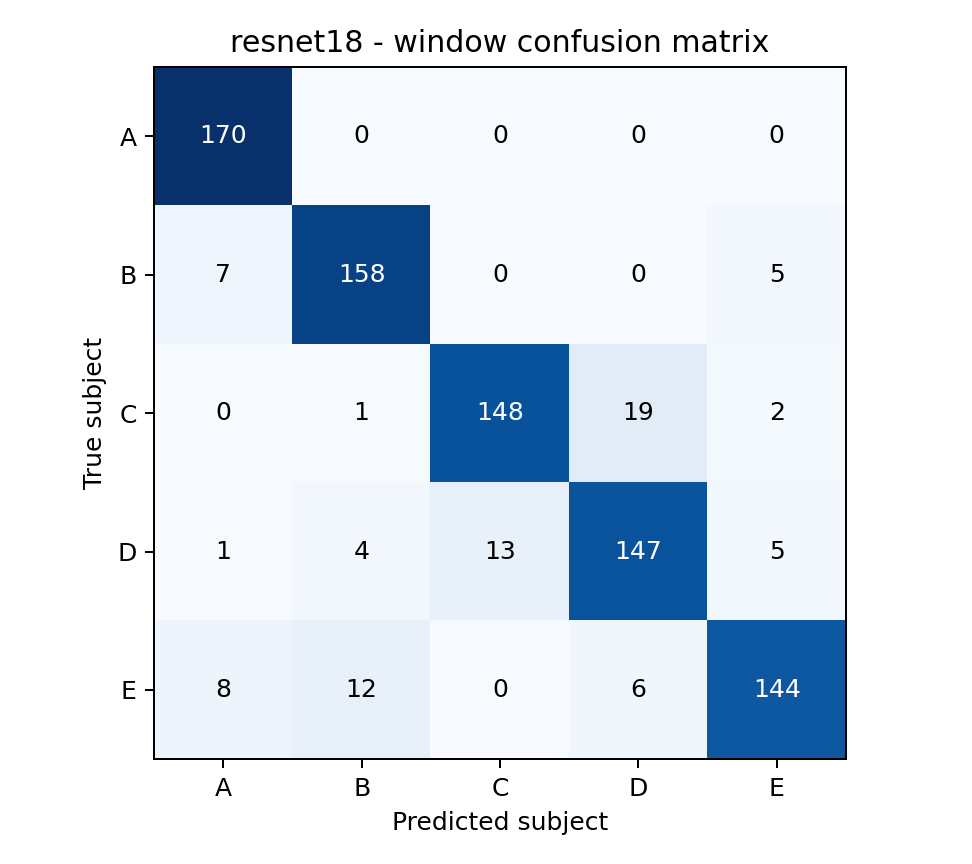
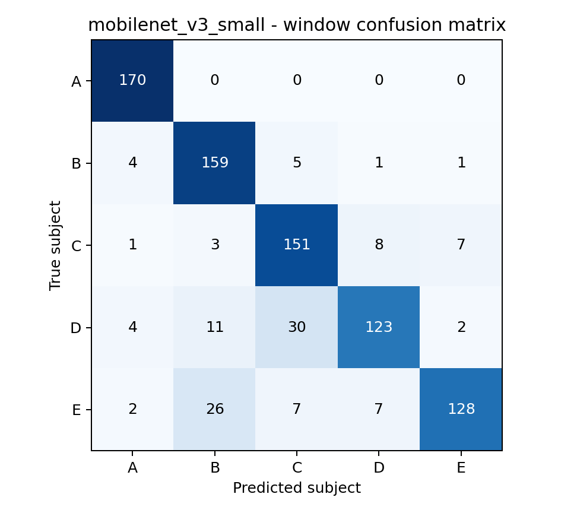
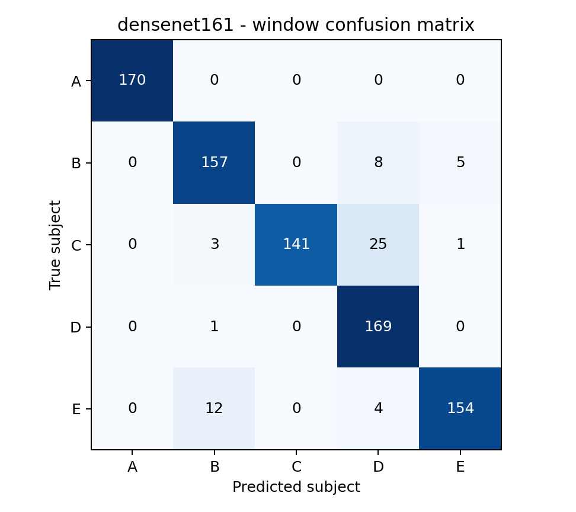

# 손바닥 sEMG 피험자 분류 실험

손바닥 근전도(sEMG)로 피험자 A~E 중 누구인지 분류했다. 손잡이 잡기·회전·정지의 동작 종류를 분류한 실험은 아니다. 같은 데이터 분할에서 세 모델을 비교했고, 표의 수치는 저장된 모델을 테스트 데이터에 적용해 얻었다.

1주차에는 데이터 파일을 확인하고 세 사람의 신호를 그렸다([파일 요약](results/file_summary.csv), [신호 비교](results/subjects_comparison.png)). 2주차에는 그 신호를 전처리해 모델을 학습했다. 3주차 내용인 테스트 평가, 모델 비교, 혼동행렬 분석을 아래에 이어서 정리했다. 추가 기능으로 새 사람의 신호 3개 이상을 등록해 곧바로 인증하는 방법도 만들었다. `main.py`가 이 순서로 실행하며 이미 끝난 학습은 저장된 결과를 재사용한다.

## 1. 코드 설명

### 데이터와 전처리

`data-source.zip`에 피험자 5명, 각 50회, 총 CSV 250개가 들어 있다. 파일마다 1,000 Hz로 측정한 3초 길이의 두 채널 신호가 있다. `python main.py`를 실행하면 필요한 CSV를 `data/data/`에 자동으로 꺼낸다. 원본 배포 파일은 이미 필터링된 데이터이며, 코드에서는 60 Hz 노치와 20~499 Hz 대역통과 필터를 한 번 더 적용한다.

원본 파일을 먼저 학습 160개, 검증 40개, 테스트 50개로 나눈 뒤 윈도우를 만들었다. 같은 시행의 윈도우가 서로 다른 집합에 섞이지 않게 하기 위해서다. ResNet18로 길이 100·200·300·400·600 ms와 겹침 0·50·75%의 **15조건**을 각각 5 epochs 동안 비교했다. 검증 점수가 가장 높은 조건은 **600 ms 길이, 150 ms 간격(75% 겹침)**이었다. 강의 기본 300/150 ms의 검증 윈도우 F1은 0.8020, 선택한 600/150 ms는 0.9056이었다. 전체 결과는 [윈도우 비교표](results/week2_experiments/window_comparison.csv)에 있다.

각 윈도우를 0~1로 정규화하고 Morlet CWT를 적용했다. 입력은 두 채널의 CWT와 그 평균 맵을 쌓은 3채널 배열이다. PNG 이미지를 학습에 넣은 것은 아니며, [OpenCV 색상 맵 그림](results/week2_experiments/cwt_opencv_300ms.png)은 300 ms 예시를 확인할 때만 사용했다.

### 모델과 학습

ResNet18, MobileNetV3-Small, DenseNet161을 모두 사전학습 가중치 없이 학습했다. 세 모델은 선택한 윈도우에서 각각 10 epochs 동안 비교했다. 검증 시행 macro F1 → 검증 윈도우 macro F1 → 낮은 검증 loss 순으로 고른 DenseNet161만 최대 40 epochs까지 연장했고, epoch 27에서 조기 종료했다. 실제 테스트에 사용한 DenseNet161 체크포인트는 **epoch 17**이다. 다른 두 모델은 각각 epoch 8, epoch 10 체크포인트라서 최종 테스트 표는 같은 횟수로 학습한 비교가 아니다. 동일하게 10 epochs까지 학습한 검증 비교는 [모델 비교표](results/week2_experiments/model_comparison.csv)에 있다.

옵티마이저는 Adam, 초기 학습률 0.001, 배치 크기 16을 사용했다. 학습률은 검증 loss에 따라 줄였다. 윈도우의 예측 확률을 시행별로 평균해 시행 하나의 피험자를 결정했다. 분할 seed는 42/43, 학습 seed는 42로 고정했다. 테스트셋은 윈도우·모델 선택에 사용하지 않았다. epoch별 학습 loss, 검증 loss, 정확도, F1, 학습률과 소요 시간은 [전체 학습 기록](results/week2_experiments/training_metrics_all.csv)에 남겼다.

### 실행 방법

Python 3.9 환경에서 실행했다. 프로젝트 폴더에서:

```bash
python3 -m venv .venv
.venv/bin/python -m pip install -r requirements.txt
.venv/bin/python main.py
```

PyCharm에서는 이 프로젝트의 `.venv`를 인터프리터로 선택한 뒤 `main.py`를 실행하면 된다. 원본 압축 파일만 있고 중간 결과가 없는 경우 15개 윈도우 조건과 세 모델을 처음부터 학습하므로 시간이 오래 걸리고 CWT 배열에 큰 디스크 공간이 필요하다. 완료된 결과가 있으면 재사용한다. 평가 결과는 `results/submission/`에 저장된다.

| 파일 | 역할 |
|---|---|
| `main.py` | 데이터 압축 해제, 전처리·학습·평가 순서대로 실행 |
| `week1.py` | 1주차 파일 요약과 신호 그림 생성 |
| `week2_signal.py`, `week2_data.py` | 신호 필터링·CWT 및 최초 시행 분할 |
| `week2_experiments.py`, `experiments/data.py` | 윈도우 후보 비교와 실험 데이터 생성 |
| `experiments/training.py` | 세 모델 생성·학습과 검증 기록 |
| `evaluation.py` | 세 모델의 테스트 지표 및 혼동행렬 저장 |
| `experiments/comparisons.py`, `experiments/memo.py` | 조건별·epoch별 수치 정리 |
| `enrollment_features.py`, `enrollment.py` | 새 사용자 특징 추출, 템플릿 저장·비교 |
| `enroll.py` | 새 사용자 등록·식별·인증 명령 |
| `enrollment_experiment.py` | 새 사용자 등록 전후 비교 결과 생성 |

## 2. 모델 성능 비교

같은 테스트 **850개 윈도우**를 기준으로 계산했다. Precision, Recall, F1은 피험자 5명의 **macro 평균**이며 수치는 %다.

| 모델 | 사용 epoch | Accuracy | Precision | Recall | F1-score |
|---|---:|---:|---:|---:|---:|
| ResNet18 | 8 | 90.24 | 90.28 | 90.24 | 90.17 |
| MobileNetV3-Small | 10 | 86.00 | 86.66 | 86.00 | 85.79 |
| DenseNet161 | 17 | **93.06** | **93.81** | **93.06** | **93.09** |

DenseNet161이 이 테스트에서 가장 높았고 MobileNetV3-Small이 가장 낮았다. 10 epochs 단계의 검증 윈도우 F1도 DenseNet161 0.9259, ResNet18 0.9201, MobileNetV3-Small 0.8957 순이었다. DenseNet161은 파라미터가 약 2,648만 개로 가장 크지만, 모델 크기만으로 점수 차이의 원인을 단정할 수는 없다. 테스트 수치 원본은 [모델별 지표 CSV](results/submission/model_metrics.csv)와 [행렬 수치 JSON](results/submission/model_results.json)에 있다.

10 epochs까지 학습할 때의 비용도 기록했다. 시간은 이 컴퓨터에서 측정한 학습+검증 시간이며 전처리 시간은 빠져 있다.

| 모델 | 10 epochs 검증 윈도우 F1 | 파라미터 수 | 10 epochs 학습+검증 시간 |
|---|---:|---:|---:|
| ResNet18 | 0.9201 | 11,179,077 | 94.8초 |
| MobileNetV3-Small | 0.8957 | 1,522,981 | 45.2초 |
| DenseNet161 | 0.9259 | 26,483,045 | 612.6초 |

같은 테스트 50개 **시행**은 세 모델 모두 50개를 맞혀 Accuracy·macro Precision·Recall·F1이 전부 100%였다. 윈도우 단위의 틀린 예측도 시행별 확률 평균 과정에서 보완된 것이다. 이 결과는 기존 피험자 5명의 다른 시행에 대한 결과이며, 처음 보는 사람이나 다른 날 측정에도 100%가 나온다는 뜻은 아니다.

## 3. Confusion Matrix 분석

아래 그림은 **윈도우 기준**이다. 행이 실제 피험자, 열이 예측 피험자이고 각 행에는 170개 윈도우가 있다. 세 모델의 시행 기준 행렬도 함께 저장했다.

### ResNet18



[시행 기준 행렬](results/submission/confusion_matrix_resnet18_trial.png) · A가 170/170으로 가장 잘 분류됐다. E는 144/170으로 가장 적게 맞혔다. 가장 큰 오분류는 C→D 19개이고 D→C도 13개였다. C와 D의 일부 윈도우가 이 모델에서는 비슷한 특징으로 보였을 가능성이 있다.

### MobileNetV3-Small



[시행 기준 행렬](results/submission/confusion_matrix_mobilenet_v3_small_trial.png) · A가 170/170으로 가장 잘 분류됐다. D는 123/170으로 가장 적게 맞혔다. D→C 30개, E→B 26개가 큰 오분류다. 세 모델 중 이 두 피험자에서 틀린 윈도우가 가장 많아 전체 F1이 낮아졌다.

### DenseNet161



[시행 기준 행렬](results/submission/confusion_matrix_densenet161_trial.png) · A가 170/170, D가 169/170으로 잘 분류됐다. C는 141/170으로 가장 적게 맞혔다. 가장 큰 오분류는 C→D 25개였고 E→B도 12개였다. 전체 점수는 가장 높지만 C와 D를 헷갈리는 윈도우는 남아 있다.

## 4. 최종 결과

여기서는 최종으로 선택한 600 ms 길이·150 ms 간격의 테스트 윈도우 **850개**를 평가했다. 앞에서 만든 기본 300 ms 길이·150 ms 간격의 테스트 윈도우는 950개지만, 아래 점수는 그 결과가 아니다.

- 가장 높은 모델: **DenseNet161**. 850개 중 **791개를 맞혀 정확도(Accuracy) 93.06%**였다. 사람별 F1 점수를 평균한 **macro F1은 93.09%**다.
- 가장 낮은 모델: **MobileNetV3-Small**. 850개 중 **731개를 맞혀 정확도(Accuracy) 86.00%**였다. 사람별 F1 점수를 평균한 **macro F1은 85.79%**다.
- 주로 헷갈린 피험자: 모델에 따라 **C↔D**, **E→B**가 두드러졌다.
- 시행 기준은 모두 100%였지만, 윈도우 기준으로 보면 모델 차이가 분명했다. 한 번의 분할·한 번의 seed로 얻은 수치라서 일반적인 성능이라고 단정하기는 어렵다. 테스트 파일 E의 두 개는 내용이 완전히 같아서 고유 신호 49개 기준도 확인했으며, DenseNet161의 시행 정확도는 이 경우에도 100%였다.

### 전체적인 실험 결과 및 느낀 점

15가지 윈도우를 비교한 결과 600 ms 길이·150 ms 간격이 검증에서 가장 좋았다. 같은 조건으로 세 모델을 테스트한 정확도는 DenseNet161 93.06%(850개 중 791개), ResNet18 90.24%, MobileNetV3-Small 86.00%(850개 중 731개) 순이었다. 50개 시행 기준은 세 모델 모두 맞혔지만, 윈도우별로는 C를 D로, E를 B로 잘못 판단한 경우가 남았다. 새 사용자 등록 실험의 미등록자 거부율은 평균 86.3%였지만 C를 미등록자로 뒀을 때는 42.9%에 그쳤다. 다섯 명의 같은 환경 데이터에서는 분류가 잘 됐어도 이 수치만으로 실제 인증에 안전하다고 보기는 어렵다.

실험하면서 느낀 건 손바닥 신호만으로 사람을 인증하는 것은 비효율적이고 취약할 수 있다는 점이다. 같은 사람도 측정할 때마다 신호가 달라질 수 있고, 다른 사람의 신호도 비슷하게 나타날 수 있다. 만약 1억 명이 손바닥 신호를 등록한다면 서로 비슷한 신호가 하나도 없을까 하는 의문이 든다. 이번 실험은 5명만 다뤘기 때문에 실제로 얼마나 겹칠지는 알 수 없다. 반면 지문은 사람마다 고유한 무늬가 있어 서로 겹칠 가능성이 낮다. 그렇기에 손바닥 신호만 단독으로 쓰기보다 신호가 겹치는 문제를 줄일 다른 방안을 찾거나, 지문 같은 또 다른 인증 방법과 결합해서 사용해야 한다고 생각한다.

처음에는 `week2_signal.py` 파일 전체를 SHA-256으로 확인했기 때문에 주석 한 글자나 줄바꿈만 바꿔도 64자리 확인값이 완전히 달라졌다. 그러면 전처리 코드가 실제로 바뀐 것처럼 판단해서 저장된 학습 결과를 재사용하지 못했다. 인식률이나 loss가 바뀐 건 아니었고, 별도 사본에서 전처리와 학습을 처음부터 다시 실행해 정확도와 혼동행렬까지 대조하니 기존 결과와 같았다. 하지만 이걸 확인하려고 실험과 README 기록을 전부 다시 살펴봐야 해서 꽤 번거로웠다. 과정이 생각보다 복잡해서 앞으로는 작은 변경을 할 때도 무엇이 달라졌는지 더 꼼꼼하게 확인해야겠다고 느꼈다.

## 5. 추가 기능: 새 사용자 즉석 등록

핸드폰에 새 지문을 등록하듯 새 사람의 손바닥 sEMG 시행 3개 이상을 추가하는 기능이다. 기존 DenseNet161은 A~E 다섯 명으로 출력이 고정돼 있으므로 이 기능에는 사용하지 않았다. 대신 3초 신호의 동작 구간·채널별 진폭과 주파수 특징 54개를 추출해 사용자별 템플릿을 저장한다. 등록할 때 기존 사용자의 모델 가중치, 정규화 값, 승인 기준을 다시 학습하지 않는다. 같은 파일이나 동일한 내용의 신호를 여러 번 등록하는 것도 막았다.

`main.py`를 실행하면 A~D만 등록된 데모 저장소 `results/enrollment/demo_initial.json`과 등록 전후 [평가표](results/enrollment/evaluation.csv), [상세 실험 메모](results/enrollment/report.md), [파일 분할표](results/enrollment/split.csv)가 생성된다. 데모에서 E를 새 사람으로 직접 등록하려면 다음을 실행한다.

```bash
.venv/bin/python enroll.py --db results/enrollment/demo_initial.json register E 'data/data/E/e (43).csv' 'data/data/E/e (32).csv' 'data/data/E/e (26).csv' 'data/data/E/e (4).csv' 'data/data/E/e (41).csv'
.venv/bin/python enroll.py --db results/enrollment/demo_initial.json show
.venv/bin/python enroll.py --db results/enrollment/demo_initial.json identify 'data/data/E/e (1).csv'
.venv/bin/python enroll.py --db results/enrollment/demo_initial.json verify E 'data/data/E/e (1).csv'
```

실제 새 사용자는 위 명령의 `E`와 CSV 파일들을 새 ID 및 새로 측정한 파일로 바꾸면 된다. CSV는 기존 데이터와 같은 **3초·1,000 Hz·두 채널 형식**이어야 한다. `identify`는 가장 가까운 등록 사용자 또는 판정 보류를 출력하고, `verify`는 주장한 ID와 일치하는지 판정한다. 초기 저장소를 처음부터 만들 때는 먼저 두 사람 이상을 각각 등록하고, 등록에 사용하지 않은 별도 파일의 `subject,file,split` CSV로 `calibrate`를 실행해야 한다. 위 데모는 보정까지 끝난 상태다.

5명 중 한 명씩 빼서 미등록자로 취급한 뒤 등록 전후를 비교했다. 사람마다 등록 5회, 별도 검증 10회, 나머지 테스트 34~35회다. 다섯 회 평균 미등록자 거부율은 **86.3%**, 등록 후 새 사용자 식별률은 **90.2%**, 등록 후 기존 사용자 식별률은 **82.5%**였다. 특히 C를 미등록자로 뒀을 때 거부율은 **42.9%**라서 모르는 사람을 안정적으로 막는다고 할 수 없다. 이는 원래 다섯 사람을 같은 측정 환경에서 나눠 본 추가 기능 실험이며, 다른 날 재측정이나 진짜 처음 보는 사람, 위조 신호에 대한 검증은 아니다. 개발 중 테스트 결과를 살펴본 뒤 검증 데이터로 기준을 조정했으므로 독립적인 최종 성능 추정치로 보기도 어렵다.

템플릿 JSON은 원본 CSV를 담지는 않지만 생체신호에서 파생된 값이므로 **로컬에만 보관**한다.
